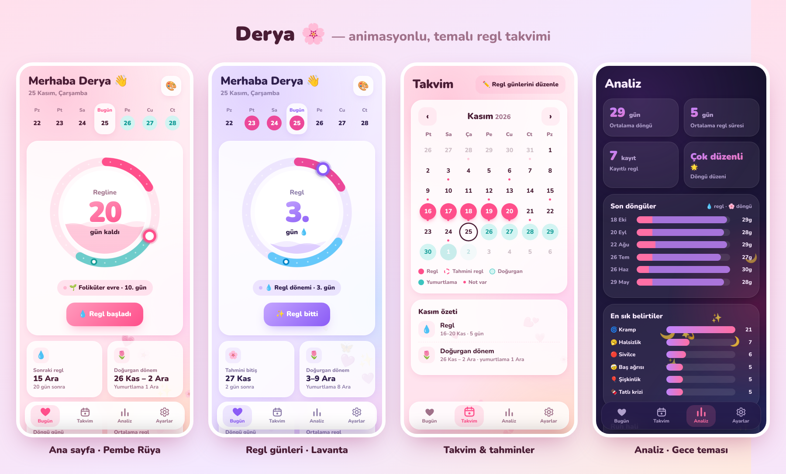

# Derya 🌸 — Regl Takvimi (iPhone & Android)

Animasyonlu, 5 farklı temalı, Türkçe bir regl (adet) takip uygulaması. Sevgiyle hazırlandı 💗



## 🍎 iPhone'a yükleme

iPhone'a APK kurulmaz; uygulama iPhone'da **web uygulaması** olarak çalışır (aynı arayüz):

1. iPhone'da **Safari** ile şu adresi aç: **https://baykerembereketlioglu0-del.github.io/Derya/**
2. **Paylaş** düğmesine (kare içinde yukarı ok) dokun → **"Ana Ekrana Ekle"** → **Ekle**.
3. Bundan sonra uygulamayı hep ana ekrandaki **Derya 🌸** ikonundan aç
   (Safari sekmesindeki kayıtlar ile ana ekran uygulamasının kayıtları ayrı tutulur).

İlk açılıştan sonra internetsiz de çalışır; veriler sadece telefonda saklanır.
iPhone'da zamanlanmış bildirim yok; regl yaklaşınca ana sayfada uyarı çıkar.

> Site yayında değilse: GitHub'da repo → **Settings → Pages** → *Build and deployment* altında
> **Source: Deploy from a branch**, **Branch: `ccr-1673116a-uuvdga`**, klasör **`/docs`** → **Save**.
> 1–2 dakika sonra adres açılır.

## 🤖 Android'e yükleme

1. **[apk/Derya-Regl-Takvimi.apk](apk/Derya-Regl-Takvimi.apk)** dosyasını telefona indir
   (GitHub'da dosyayı açıp **"Download raw file"** / indir düğmesine bas).
2. İndirilen dosyaya dokun. Android "bilinmeyen kaynaklardan yükleme" izni isterse ver.
3. Play Protect "tanınmayan uygulama" uyarısı gösterirse **"Yine de yükle"** de
   (uygulama Play Store'dan gelmediği için bu uyarı normaldir).

Android 7.0 ve üzeri gerekir.

## ✨ Özellikler

- **Ana sayfa:** dönen işaretçili döngü halkası, içinde dalgalanan "su" animasyonu,
  regle kalan gün / regl'in kaçıncı günü / gecikme bilgisi, haftalık şerit
- **Tek dokunuşla** "Regl başladı" / "Regl bitti" (bugün, dün, 2 gün önce ya da takvimden seç)
- **Tahminler:** sonraki regl, doğurgan dönem, yumurtlama günü — kayıtlar arttıkça
  uygulama kendi ortalamasını öğrenir
- **Takvim:** regl, tahmini regl, doğurgan dönem ve yumurtlama renkli; kaydırarak ay
  değiştirme; "düzenle" modunda geçmiş günleri işaretleme
- **Günlük kayıt:** akış yoğunluğu, ruh hali, belirtiler (kramp, baş ağrısı, şişkinlik…), not
- **Analiz:** ortalama döngü/regl süresi, döngü düzeni, son döngüler grafiği, en sık belirtiler
- **5 tema:** Pembe Rüya, Lavanta, Şeftali, Nane, Gece (koyu) — dairesel geçiş animasyonuyla
- **Animasyonlar:** açılış ekranında düşen damla, uçuşan kalpler/yıldızlar, konfeti patlamaları,
  zıplayan butonlar, sayılar, kart geçişleri
- **💌 Sevgi notu:** ana sayfada zarf; dokununca dönüp notu gösterir (Ayarlar'dan değiştirilebilir)
- **🔔 Hatırlatmalar:** regl yaklaşınca, regl günü, isteğe bağlı doğurgan dönem başında bildirim
- **💾 Yedek:** verileri paylaş / geri yükle (telefon değiştirirken)
- **🔒 Gizlilik:** internet izni yok, veriler sadece telefonda saklanır
- Gizli sürpriz: ana sayfada isme 5 kez dokun 💕

> Tahminler ortalamalara dayanır ve tıbbi tavsiye değildir; doğum kontrolü yöntemi
> olarak kullanılmamalıdır.

## 🛠️ Kaynaktan derleme

Android Studio / Gradle gerekmez; Ubuntu/Debian paketleri yeterli:

```bash
sudo apt install openjdk-17-jdk aapt zipalign apksigner dalvik-exchange android-sdk-platform-23
./build.sh          # → apk/Derya-Regl-Takvimi.apk
```

- Arayüz: `docs/` (HTML/CSS/JS). Hem APK'nın içine konur hem de iPhone için GitHub Pages'ten yayınlanır.
- Android kısmı: `app/java/com/derya/takvim/` (WebView, bildirimler, veri saklama).
- İkonlar: `node tools/make-icons.js` (Playwright ile SVG'den çizilir).
- **İmza anahtarı** (`keystore/derya.keystore`) güvenlik için repoda tutulmaz. Güncellemeyi
  eski sürümün üstüne kurabilmek için aynı anahtar `keystore/` klasöründe olmalı; yoksa
  `build.sh` yeni bir anahtar üretir ve telefondaki eski sürümün önce kaldırılması gerekir
  (kaldırmadan önce uygulamadan yedek al).

Yazı tipi: [Nunito](https://fonts.google.com/specimen/Nunito) (SIL Open Font License 1.1).
